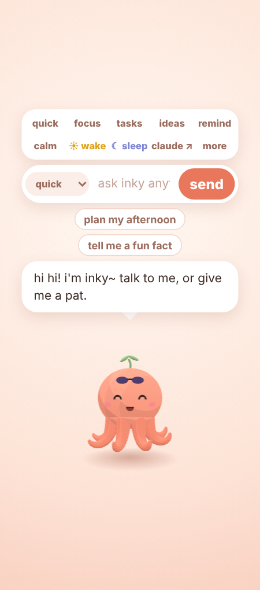
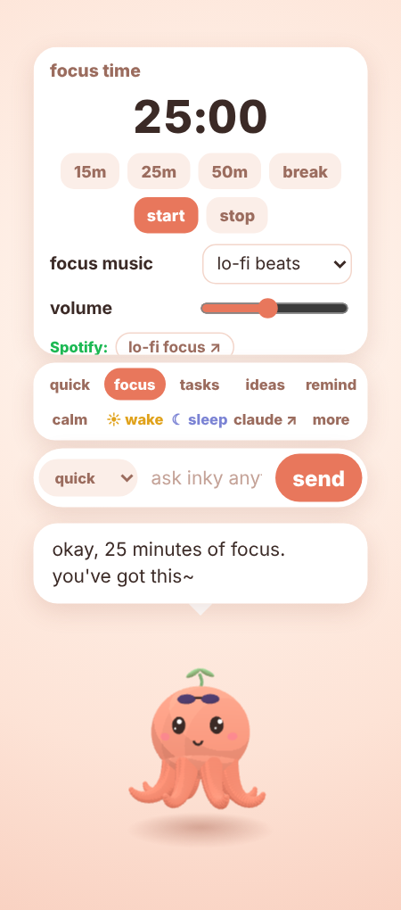
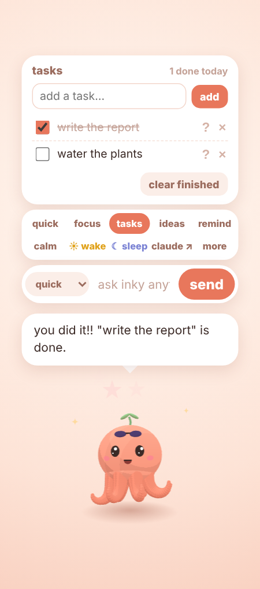
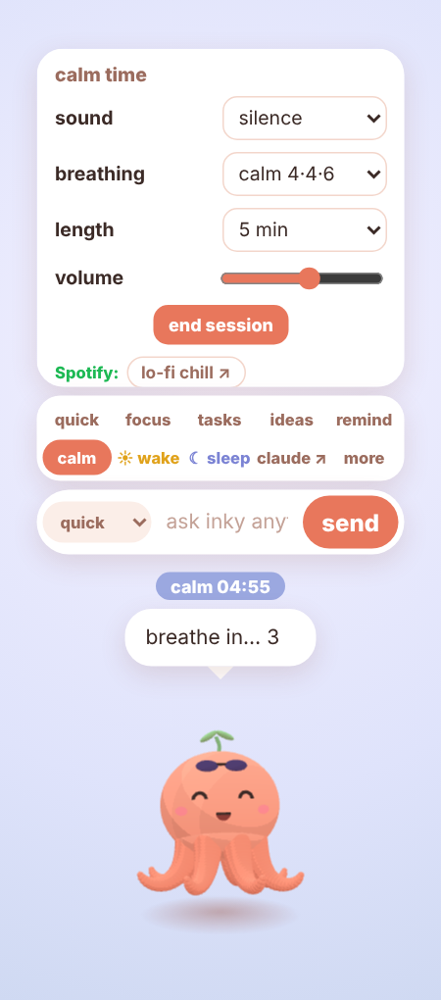

# Inky — a cute 3D octopus desktop buddy

<p align="center">
  
</p>

Inky is a tiny peach octopus that lives on your screen. Pat it, spin it around in 3D, chat with it, and let it help you start your morning, focus, take breaks, meditate and wind down for bed.

Everything is in **one HTML file** (`index.html`). Open it in a browser and it works. Open it as a Claude artifact and you also get AI chat, voice, and an installable floating desktop app.

---

## Features

| | |
|---|---|
| **3D Inky** | A real 3D octopus with eight curly tentacles. Drag it to spin it any direction (it has spots on its back). Its eyes follow your cursor, and it blinks and breathes. |
| **Lively reactions** | About a dozen different reactions when you pat it (jumps, flips, spins, dances, a rainbow shimmer, an ink puff…), never the same one twice in a row. Click fast and it gets dizzy. There are a few rare surprises too. |
| **Tidy by default** | Usually it's just Inky. Pat it and the menus appear. They fold away on their own after you stop using them, or when you double-click Inky. |
| **Chat** *(in Claude)* | Ask Inky anything. Its face changes with the mood of its answer, and you get quick-reply buttons to keep going. Pick a model: quick, balanced, deep, Haiku, Sonnet or Opus. |
| **Voice** *(in Claude)* | Talk to Inky with the mic. Turn on the speaker button to have Inky read its replies aloud, in a voice you choose. |
| **Quick instructions** | One-tap prompts like "help me plan my next hour". Add your own. |
| **Hand off to other bots** | Inky writes a prompt for Claude, Codex, ChatGPT or Gemini that you copy and open. In the desktop app it can also talk directly to Claude Code, Codex CLI, Gemini CLI or Ollama on your Mac, and open the ChatGPT app. |
| **Focus timer** | 15, 25 or 50 minute sessions with breaks, and a session count for the day. Focus music: lo-fi beats, sunny beats, lo-fi chill, lo-fi + rain, warm piano, brown noise, rain, ocean, forest, fireplace, pads, space drift. |
| **Tasks** | A simple to-do list. Inky celebrates when you finish one, and the **?** button asks it to break a task into steps. |
| **Ideas** | Catch quick ideas by typing, by voice, or by typing `idea: …` in the chat box. Grow them with Inky, turn them into tasks, or copy them all. |
| **Reminders** | Stand-up and stretch nudges every 30–90 minutes, and check-ins about your open tasks. They wait until a focus session ends. |
| **Calm** | Guided breathing (4·4·6, box, 4·7·8, or just float) with calming sounds: ocean, lo-fi chill, lo-fi + rain, warm piano, music box, pads, space drift, rain, forest, crackling fireplace, night crickets, singing bowls. Inky closes its eyes and grows and shrinks with your breaths. |
| **☀ Morning routine** | One button starts sunny wake-up music. Inky walks you through brushing your teeth (with a 2-minute timer), going over today's tasks, wake-up music, a 2½-minute mini workout (Inky moves along), 5 minutes of sunlight, and breakfast. |
| **☾ Sleep routine** | One button starts sleepy music and dark mode, and Inky puts on its nightcap. It walks you through dimming the lights, drinking water, laying out tomorrow's clothes and brushing your teeth (with a 2-minute timer), then a short **sleep journal**. Then "goodnight": the music fades out after a timer you choose. |
| **Time of day** | Inky has a dew drop in the morning, sunglasses in the afternoon and a scarf in the evening. Dark mode turns on after sunset. |
| **Spotify** | Buttons open lo-fi, focus, piano, meditation or sleep music in Spotify, and you can save your own playlist. In the Mac desktop app, Inky can control the Spotify app itself (play, pause, skip, see what's playing). |

All music is generated live in the page with the Web Audio API, so there are no audio files and nothing to download.

<p align="center">
  
  
  
  
  
  
</p>

---

## Two ways to use Inky

### 1. In a web browser (anyone, no account needed)

1. Download `index.html` (or the whole repo as a ZIP: **Code → Download ZIP**).
2. Double-click `index.html` to open it in Chrome, Edge, Safari or Firefox.

Or use the hosted copy, if this repo has GitHub Pages turned on (see [Hosting on GitHub Pages](#hosting-on-github-pages)).

**Works in the browser:** 3D Inky and all its reactions, focus timer and music, tasks, ideas, reminders (while the tab is open), calm, the morning and sleep routines, the journal, time-of-day looks, dark mode, and Spotify links.

**Needs Claude (option 2):** chat, voice, the floating desktop app, menu bar, notifications, talking to bots on your Mac, and Spotify app control.

> The first time, the page needs an internet connection to load the 3D library (three.js) and the font. If the 3D library can't load, Inky falls back to a flat 2D drawing.

### 2. In Claude (full experience, including the desktop app)

Inky uses Claude's artifact features for chat, voice and the desktop app, so this route needs a [Claude](https://claude.ai) account.

**Make your own copy:**

1. Start a chat in Claude and attach `index.html`.
2. Ask: *"Publish this file as an artifact and declare the `desktop`, `sample`, `dictation` and `tts` capabilities."*
3. Open the artifact Claude creates.

**Install it as a desktop app** (Claude desktop app for Mac or Windows):

1. Open your Inky artifact in the **Claude desktop app**.
2. Pat Inky, tap **more**, then **install inky as a desktop app** (or use **Install as app** in the artifact's menu).
3. Open the new **Inky** app, pat it, then **more → set me up**. This lets Inky float on top of your other windows, sit in the menu bar, send notifications, and use the **⌥⇧I** shortcut.
4. Optional: in **quick → find bots on my Mac**, grant full access so Inky can talk to command-line bots and control Spotify.

> Some features only work in certain places:
> - Voice only works in Claude's main window and in Chrome, so it may be hidden in the floating desktop app.
> - Chat and voice are only offered to people in the artifact owner's organization.
> - Full access (bots on your Mac, Spotify control) only works for artifacts you own.

---

## How to use

| Do this | To |
|---|---|
| **Click** Inky | Pat it and open the menus |
| **Drag** Inky | Spin it around in 3D (flick for momentum) |
| **Double-click** Inky | Fold everything back to just Inky |
| Drag the **• • • drag to move • • •** strip | Move the floating window (or use **more → move inky** for corners) |
| **⌥⇧I** (desktop app) | Bring Inky up from anywhere |
| **⌘Q** (desktop app) | Quit |

In the desktop app, the menus open upward or downward depending on where Inky sits on your screen.

**Menu tabs:** `quick` (quick instructions and hand-off to other bots) · `focus` · `tasks` · `ideas` · `remind` · `calm` · `☀ wake` (morning routine) · `☾ sleep` · `claude ↗` (opens a new Claude chat) · `more` (settings: voice, dark mode, Inky's look, Spotify playlist, move, permissions).

---

## Permissions (desktop app)

| Permission | Used for |
|---|---|
| Overlay | Floating, see-through, always-on-top window |
| Menu bar | The Inky icon in your menu bar (focus, morning and sleep routines, quick instructions, open Claude…) |
| Notifications | Timer done, task done, reminders, answers that arrive while you're in another app |
| Shortcuts | ⌥⇧I to bring Inky up |
| Full access *(optional)* | Running Claude Code, Codex CLI, Gemini CLI or Ollama for you, opening the ChatGPT app, and controlling the Spotify app with AppleScript |

Codex runs in read-only mode. Messages go to the bots through standard input, not through the shell.

## Privacy

- Your tasks, ideas, journal, settings and chat history are saved **only in your own browser or app** (in its local storage). Nothing is sent to a server by Inky itself.
- Chat messages go to Claude through Claude's own artifact runtime, only when you send one.
- Bots on your Mac run locally on your computer.

---

## Customize

Everything is in `index.html`. Search for these to change them:

- `PERSONA` — Inky's personality and reply style
- `PET_LINES`, `REACTIONS` — what Inky says and does when patted
- `MORN_STEPS`, `MOVES` — the morning checklist and mini workout
- `SLEEP_STEPS` — the bedtime checklist
- `STAND_LINES`, `GREET` — reminder and greeting lines
- `LOC` — the location used to work out sunset (defaults to Toronto on Toronto time, otherwise a rough guess from your time zone)
- `CHORDS`, `LOFI`, `startSound` — the generated music

## Hosting on GitHub Pages

1. In your repo, go to **Settings → Pages**.
2. Under **Build and deployment**, choose **Deploy from a branch**, then branch `main`, folder `/ (root)`.
3. After a minute, Inky is live at `https://<your-username>.github.io/inky-desktop-bot/`.

## Project structure

```
inky-desktop-bot/
├── index.html   ← the whole app (HTML, CSS, JS, 3D model, music)
├── docs/        ← screenshots for this README
├── LICENSE
└── README.md
```

## Credits

- Made with [Claude](https://claude.ai).
- 3D rendering by [three.js](https://threejs.org) (MIT License), loaded from cdnjs.
- Font: [Nunito](https://fonts.google.com/specimen/Nunito) (SIL Open Font License), from Google Fonts.
- Inky is an original character.

## License

[MIT](LICENSE): free to use, change and share.
