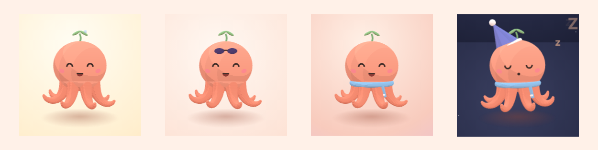
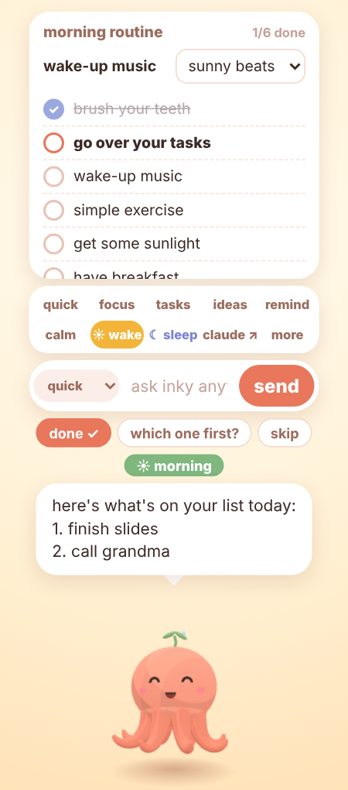
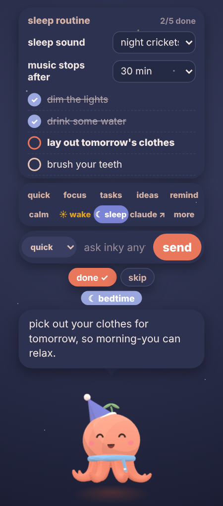

# inky-desktop-bot-with-background

> A cute 3D octopus desktop buddy in a cozy app window with a soft background.

<p align="center"></p>

<p align="center"></p>

Inky is a tiny peach octopus that keeps you company while you work. Pat it, spin it around in 3D, chat with it, and let it help you start your morning, focus, take breaks, meditate and wind down for bed.

Everything is in **one HTML file** (`index.html`). Open it in a browser and it works. Install it through Claude and you also get AI chat, voice, and a desktop app.

*Looking for just Inky floating on your desktop with no window or background? See **inky-bot**.*

---

## Which version is this?

There are two versions of Inky. They have the same features and differ only in how they sit on your screen in the desktop app.

| | **inky-bot** | **inky-desktop-bot-with-background** |
|---|---|---|
| Looks like | Just Inky, floating on your desktop | Inky in a cozy app window with a soft background |
| Window | None: no frame and no background, and clicks pass through the empty space around Inky | A small window you can move around |
| Moving it | Hover over Inky and drag the **• • • drag to move • • •** handle that appears | Drag the handle (always visible) |
| Best for | A pet that lives on your desktop | A little app you open when you need it |
| How it starts floating | Pat Inky once and allow it | **more → set me up** |

## Features

| | |
|---|---|
| **3D Inky** | A real 3D octopus with eight curly tentacles. Drag it to spin it any direction (it has spots on its back). Its eyes follow your cursor, and it blinks and breathes. |
| **Lively reactions** | About a dozen different reactions when you pat it (jumps, flips, spins, dances, rainbow shimmer, an ink puff…), never the same one twice in a row. Click fast and it gets dizzy. There are rare surprises too: its sprout blooms, or it turns gold. |
| **Tidy by default** | Usually it's just Inky. Pat it and the menus appear. They fold away after about 25 seconds without use, or when you double-click Inky. |
| **Chat** *(in Claude)* | Ask Inky anything. Its face changes with the mood of its answer, and quick-reply buttons help you keep going. Choose a model: quick, balanced, deep, Haiku 4.5, Sonnet 5.5 or Opus 5.5. |
| **Voice** *(in Claude)* | Talk with the mic button. Turn on the speaker button to hear Inky's replies, and choose its voice under **more**. |
| **Quick instructions** | One-tap prompts like "help me plan my next hour". Add or remove your own. |
| **Hand off to other bots** | Inky writes a prompt for Claude (the default), Codex, ChatGPT or Gemini, which you copy and open. In the desktop app with full access, it can also talk directly to Claude Code, Codex CLI, Gemini CLI or Ollama on your Mac and show you their replies, or open the ChatGPT app. |
| **Focus timer** | 15, 25 or 50 minute sessions plus breaks, with a session count for the day. The time left shows on the Dock icon and in the menu bar. Focus music: lo-fi beats, sunny beats, lo-fi chill, lo-fi + rain, warm piano, brown noise, rain, ocean, forest, fireplace, pads, space drift, or your Spotify. |
| **Tasks** | A to-do list. Inky cheers and sends a notification when you finish one, and **?** asks it to break a task into steps. |
| **Ideas** | Save quick ideas by typing, by voice, or by typing `idea: …` in the chat box. Grow them with Inky (✦), turn them into tasks (→), or copy them all. |
| **Reminders** | Stand-up and stretch nudges (every 30, 45, 60 or 90 minutes), with "i stood up!" and "snooze" buttons, plus task check-ins. They wait while you're focusing, meditating or in a routine. |
| **Calm** | Guided breathing (4·4·6, box, 4·7·8, or just float) with sounds: ocean, lo-fi chill, lo-fi + rain, warm piano, music box, pads, space drift, rain, forest, crackling fireplace, night crickets, singing bowls, or Spotify. Inky closes its eyes and grows and shrinks with your breaths. |
| **☀ Morning routine** | One tap starts wake-up music, then Inky walks you through brushing your teeth (2-minute timer), going over today's tasks, wake-up music, a 2½-minute mini workout (Inky moves along), 5 minutes of sunlight, and breakfast. |
| **☾ Sleep routine** | One tap starts sleepy music and dark mode, and Inky puts on its nightcap. It walks you through dimming the lights, drinking water, laying out tomorrow's clothes and brushing your teeth, then a short **sleep journal** (a good thing about today, what's on your mind, the first thing tomorrow). Then "goodnight": the music fades after 15, 30 or 60 minutes. |
| **Time of day** | A dew drop in the morning, sunglasses in the afternoon, a scarf in the evening. Dark mode with stars starts after sunset. You can also choose a look or force light or dark mode. |
| **Spotify** | Buttons open matching music in Spotify, and you can save your own playlist. In the Mac desktop app with full access, Inky controls the Spotify app itself: play, pause, skip, see what's playing, and start your playlist when a session begins. |
| **Smart placement** *(desktop app)* | Move Inky anywhere, or jump to a corner or the center. The menus open upward or downward depending on where Inky sits on your screen. |

All built-in music is generated live in the page with the Web Audio API, so there are no audio files.

<p align="center">
  
  
  
  
  
  
</p>

---

## Install

There are two ways to use Inky.

### A. As a desktop app (full experience)

You need a [Claude](https://claude.ai) account and the **Claude desktop app** (macOS or Windows). Inky runs as a Claude *artifact*, and Claude can install artifacts as desktop apps.

1. **Create your Inky artifact** (one time):
   1. Download `index.html` from this repo.
   2. In the Claude desktop app, start a new chat and attach `index.html`.
   3. Send this message:
      > Publish this file as an artifact titled "inky-desktop-bot-with-background", and declare the `desktop`, `sample`, `dictation` and `tts` capabilities.
   4. Claude replies with a link to your new artifact. Open it.
   - *Already have a link?* If someone shared their Inky artifact with you, open that link in the Claude desktop app and skip ahead. Some features are limited for shared copies (see [Good to know](#good-to-know)).
2. **Install it as an app:** pat Inky, tap **more → install inky as a desktop app**, and confirm. You can also use **Install as app** in the artifact's menu.
3. **Open the app.** Inky opens with its own octopus icon in the Dock.
4. **Set it up.** Pat Inky, then tap **more → set me up**, and allow the permissions it asks for (floating on top, menu bar, notifications, shortcut).
   - If Inky says *"almost! quit me (cmd+q) and open me again"*, press **⌘Q** and open it again.
5. **Move it** by dragging the **• • • drag to move • • •** strip, or use **more → move inky** (↖ ↗ ◎ ↙ ↘).
6. *(Optional)* **Bots on your Mac and Spotify:** tap **quick → find bots on my Mac** and allow **full access**. The first time Inky controls Spotify, macOS asks whether it may; click **OK**.
7. *(Optional)* **Start at login:** System Settings → General → Login Items → add Inky.

### B. In a web browser (no account needed)

1. Download `index.html` (or **Code → Download ZIP** and unzip it).
2. Double-click `index.html` to open it in Chrome, Edge, Safari or Firefox.

You can also host it for free on [GitHub Pages](#host-it-on-github-pages).

**Works in the browser:** 3D Inky and its reactions, focus timer and music, tasks, ideas, reminders (while the tab is open), calm, the morning and sleep routines, the journal, time-of-day looks, dark mode and Spotify links.

**Needs the Claude version (A):** chat, voice, the floating desktop window, menu bar, notifications, the ⌥⇧I shortcut, bots on your Mac, and Spotify app control.

> The first time, the page needs internet to load the 3D library (three.js) and the font. If the 3D library can't load, Inky shows as a flat 2D drawing instead.

---

## Everyday use

| Do this | To |
|---|---|
| **Click** Inky | Pat it and open the menus |
| **Drag** Inky | Spin it around in 3D (flick it for momentum) |
| **Double-click** Inky | Fold everything back to just Inky |
| Drag the **• • • drag to move • • •** strip | Move Inky anywhere on your screen |
| **⌥⇧I** (Option+Shift+I) | Bring Inky up from anywhere *(desktop app)* |
| **Menu bar icon** | Talk, quick instructions, focus, break, morning and sleep routines, meditate, tasks, ideas, move, open Claude, pat, hide/show |
| **⌘Q** | Quit *(desktop app)* |

### The menu

| Tab | What's inside |
|---|---|
| `quick` | Hand off to another bot (Claude by default), **find bots on my Mac**, and your quick instructions |
| `focus` | Timer (15/25/50 min, break), focus music and volume, Spotify buttons, what you're focusing on |
| `tasks` | Add, tick off, break down (?) or delete tasks; clear finished; "done today" counter |
| `ideas` | Save ideas (type or 🎤), grow ✦, make a task →, delete, organize with Inky, copy all |
| `remind` | Stand-up interval, task check-in interval, test buttons, time until the next reminder |
| `calm` | Sound, breathing pattern, length, volume, begin/end, Spotify, and a shortcut to the sleep routine |
| `☀ wake` | Starts the morning routine. Tap again to see its checklist and choose the wake-up music. |
| `☾ sleep` | Starts the sleep routine. Tap again for the checklist, sleep sound, music timer, journal and past entries. |
| `claude ↗` | Opens a new Claude chat |
| `more` | Install, set up, permissions, tuck away, fresh chat, Spotify playlist link, Inky's look, dark mode, Inky's voice, move Inky |

### Tips

- Type `idea: buy plant food` in the chat box to save an idea instantly.
- Tap a suggestion button under Inky's reply to continue the conversation.
- Pick the model (quick, balanced, deep, Haiku, Sonnet or Opus) with the small menu at the left of the chat box.
- The menus open **upward** when Inky sits low on the screen and **downward** when it sits high.

---

## Permissions (desktop app)

Inky asks for each one the first time it's needed. You can change them later under **more → permissions**.

| Permission | Used for |
|---|---|
| Overlay | Floating, see-through, always-on-top window |
| Menu bar | The Inky icon in your menu bar |
| Notifications | Timer and routine alerts, finished tasks, reminders, answers that arrive while you're in another app |
| Shortcuts | ⌥⇧I to bring Inky up |
| Full access *(optional)* | Running Claude Code / Codex CLI / Gemini CLI / Ollama for you, opening the ChatGPT app, controlling the Spotify app with AppleScript |

Codex runs with `--sandbox read-only`. Messages reach the command-line bots through standard input, never through the shell command itself.

## Good to know

- **Voice** (mic and spoken replies) only works in Claude's main window and in Chrome, so it may be hidden in the floating desktop app. Typing always works.
- **Chat and voice** are only offered to people in the artifact owner's Claude organization. Everyone else can still use all the other features.
- **Full access** (bots on your Mac, Spotify control) is only available for artifacts you own. If you want those features, make your own copy (step 1 of [Install](#install)).
- **Updates:** if you change `index.html`, ask Claude to republish it to the same artifact. The installed app picks up the new version the next time it opens, and may ask for permissions again.
- **Data:** tasks, ideas, journal, settings and chat history are saved in the app's or browser's local storage on your computer. Clearing browser data or uninstalling removes them. Use the **copy all** buttons to back them up.

## Troubleshooting

| Problem | Try this |
|---|---|
| No "install" button | Open the artifact in the **Claude desktop app** (not a web browser). Or use **Install as app** in the artifact's menu. |
| Inky says *"quit me and open me again"* | Press **⌘Q** and reopen the app. |
| Inky can't chat (*"i can't talk from here"*) | You're using the browser version, or the artifact wasn't published with the `sample` capability. See [Install](#install). |
| No mic or speaker buttons | Voice isn't available in this window. Use Claude's main window or Chrome, or just type. |
| A permission was denied | **more → permissions** to turn it back on |
| Inky looks flat (2D) | The 3D library couldn't load. Check your internet connection and reopen. |
| Codex or another bot errors | Make sure it works in Terminal first (for example `codex exec "hi"`). Inky shows the bot's own error message. |
| Spotify buttons open the web | Tap **quick → find bots on my Mac** and allow full access in the desktop app. |
| Wrong sunset time | Edit `LOC` in `index.html` (see [Customize](#customize)). |

## Customize

Everything is in `index.html`. Search for these names:

| Name | What it controls |
|---|---|
| `PERSONA` | Inky's personality and reply style |
| `PET_LINES`, `REACTIONS`, `RARE` | What Inky says and does when patted |
| `MORN_STEPS`, `MOVES` | Morning checklist and mini workout |
| `SLEEP_STEPS` | Bedtime checklist |
| `STAND_LINES`, `GREET` | Reminder and greeting lines |
| `DEFAULT_QUICK` | Starting quick instructions |
| `LOC` | Latitude/longitude used for sunset (defaults to Toronto on Toronto time, otherwise a rough guess from your time zone) |
| `CHORDS`, `LOFI`, `WAKE_CH`, `startSound` | The generated music |
| `SPOT` | Spotify search buttons |

## Host it on GitHub Pages

1. Push this folder to a GitHub repo.
2. Go to **Settings → Pages → Build and deployment**, choose **Deploy from a branch**, then branch `main` and folder `/ (root)`, and click **Save**.
3. After about a minute it's live at `https://<your-username>.github.io/inky-desktop-bot-with-background/`.

This gives the browser version (B). For the desktop app, use Claude (A).

## Project structure

```
inky-desktop-bot-with-background/
├── index.html   ← the whole app: HTML, CSS, JavaScript, 3D model, music
├── docs/        ← screenshots used in this README
├── LICENSE
└── README.md
```

## Uninstall

- **Desktop app:** quit Inky (⌘Q), then remove it the way you'd remove any app on your computer. On a Mac, if it isn't in Applications, right-click it in the Dock while it's running and choose **Options → Show in Finder** to find it.
- **Browser:** just delete `index.html`.

## Credits

- Made with [Claude](https://claude.ai).
- 3D rendering: [three.js](https://threejs.org) (MIT License), loaded from cdnjs.
- Font: [Nunito](https://fonts.google.com/specimen/Nunito) (SIL Open Font License), from Google Fonts.
- Inky is an original character.

## License

[MIT](LICENSE): free to use, change and share.
